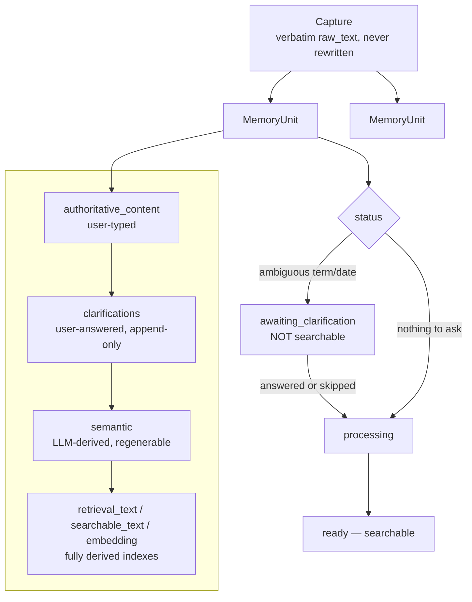
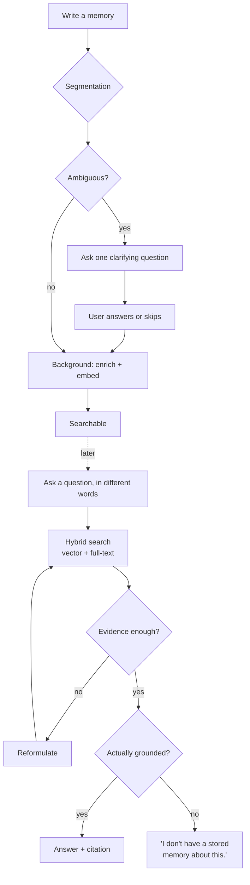

# membase

**A research prototype exploring augmented personal memory, combining
information retrieval, language models, and human-computer
interaction.**

It is not a product. membase investigates what it takes to build a
system that *remembers for you*. It should answer accurately and never
invent things it doesn't actually know. That's different from a system
that merely searches text or generates plausible-sounding answers.

## Areas of investigation

- **Information retrieval**: combine exact lexical matching with
  semantic/vector search. Search runs over *both* the original text and
  what a model derived from it. The derived layer never quietly replaces
  the original as the thing being searched.
- **Grounding as a retrieval property, not a generation afterthought**:
  the system can *refuse* to answer. It says so plainly when its own
  retrieved evidence doesn't actually support a claim.
- **LLMs as a provisional inference layer, never a database**: every
  model-derived field is explicitly regenerable. It's layered strictly
  underneath what the person actually typed, and never overwrites it.
- **Human-computer interaction**: when is it worth interrupting someone
  with a clarifying question? When does that turn a two-second note into
  an interrogation? How much ambiguity should recall resolve silently,
  versus hand back to the person, versus simply admit it doesn't know?

## High-level features

- **Capture of memory units:** one submission can describe several
  unrelated facts. The system splits it into independently retrievable
  units. The user doesn't do this manually.
- **Structurally enforced authority hierarchy:** user-typed content
  outranks what the user later clarified, which outranks what the model
  inferred, which outranks the fully-derived search index. Correcting or
  re-deriving a lower layer never touches a higher one.
- **Clarification gating:** a genuinely ambiguous term can hold a memory
  out of search until it's answered. This is bounded and skippable, and
  a real answer becomes part of the memory's stored semantics, not a
  transient chat message.
- **Grounded retrieval with explicit abstention:** hybrid search runs
  over the original text, the derived semantic representation, and
  chunked attachments. If the evidence doesn't support an answer, the
  system says so directly ("I don't have a stored memory about this")
  instead of guessing.
- **Iterative recall:** a separate, implemented retrieval path that asks
  one concrete clarifying question when several stored memories could
  plausibly answer a query, instead of picking one arbitrarily.
- **Background "structurer" pass:** once a memory is searchable, a
  background process keeps deepening its semantic representation over
  time, without blocking anything on it.
- **Contradiction surfacing:** when two stored memories disagree, that
  disagreement is flagged for the user rather than resolved
  automatically or hidden.

## Architecture

**Authority hierarchy:** highest to lowest, what the person
typed → what they later clarified → what the model inferred → the
fully-derived search indexes built from all of it. Nothing downstream is
ever allowed to overwrite something upstream of it. A re-embed or a
re-analysis can only touch its own layer, and below.

## Workflow

**Why abstention is a first-class outcome, not an error case:** the
retrieval agent is instructed to mark an answer "grounded" only if it
actually addresses the question using what was retrieved. If nothing
qualifies, the fixed abstention string is returned with no sources.
That's the same code path as a real answer, not a fallback or an
exception.

## Further reading

<code>docs/ARCHITECTURE.md</code>: the full design

Every abstraction above (`Capture`, `MemoryUnit`, the authority
hierarchy, the status gate, the retrieval `Agent`, `RecallSession`)
described in full, including the parts not covered here.

<code>docs/DECISIONS.md</code>: the decision log

What was tried, what was reversed, and why, including ideas that
evaluation didn't support.

<code>docs/REPORT.md</code>: engineering/evaluation history

Phase-by-phase findings against the real local model, not just unit
tests against fakes.

<code>docs/TODO.md</code>: open questions

What this investigation hasn't settled yet.

## License

[MIT](LICENSE)
