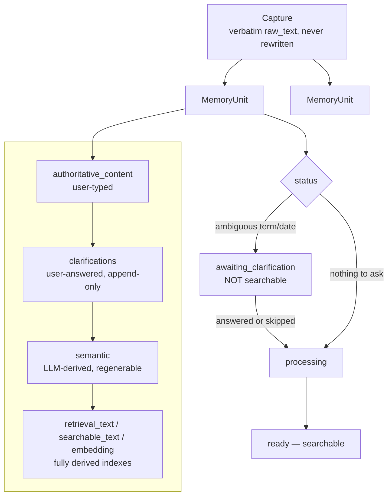
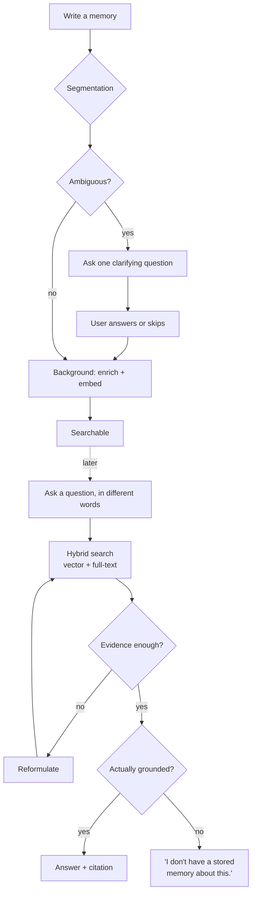

# membase

**A research prototype exploring augmented personal memory, combining information retrieval, language models, and human-computer interaction.**

## Introduction

As large language models increasingly rely on retrieval-augmented generation (RAG) and external memory systems, an important question is how information can be stored and retrieved in a way that feels natural to humans. Conventional information retrieval often assumes that users can formulate queries sufficiently close to the information they are looking for. Human recollection, however, is frequently incomplete and associative: people may remember a person, an event, a concept, or a vague connection without remembering the exact terminology or context.

Membase is an investigation into how personal memory systems can accommodate this imperfect retrieval process. It transforms unstructured input into structured memory units, extracts the relationships between them, organises them into episodes, and retrieves by association and iteration rather than by matching alone — so a memory can be reached through what surrounds it, not only through what it says. Rather than attempting to reproduce the biological implementation of human memory, the project explores which of its functional characteristics can inform the design of external memory systems.

One architectural decision shapes most of the rest: the associative graph is a **deterministic, rebuildable projection** of the stored memories, not primary data. It is derived from what extraction already produced, costs no additional model calls, and can be dropped and regenerated at any time. That is what makes a much richer representation of memory affordable without making the system depend on a fragile structure maintained separately from the memories themselves.

The broader motivation is to make information safely offloadable to machines, allowing people to rely less on maintaining every detail in their own memory while retaining the ability to recover it when needed. The design principles investigated in membase may also inform memory architectures for AI agents, where reliably storing and retrieving information over long periods remains an open problem.

## Looking at it

**[membase.vxliu.com](https://membase.vxliu.com)** is browsable without an
account. Logged out, the app reads a published snapshot of a *synthetic*
demonstration store — the memory graph, the episode timeline, the stored
memories, the evaluation report, and recordings of real recall sessions
replayed with their evidence and confidence intact. Nothing in it is a
real memory of a real person.

That mode talks to no backend at all: it reads static files, so there is
nothing to write to and no model call to trigger. A recall round costs
tens of seconds of GPU time on one 11 GB card, so running a new one —
and storing anything — needs a sign-in to a live store. See
docs/DECISIONS.md "Public demo as a static snapshot" for why a snapshot
rather than a public read-only API.

## Areas of investigation

- **Information retrieval**: combine exact lexical matching with
  semantic/vector search. Search runs over *both* the original text and
  what a model derived from it. The derived layer never quietly replaces
  the original as the thing being searched.
- **Grounding as a retrieval property, not a generation afterthought**:
  the system can *refuse* to answer. It says so plainly when its own
  retrieved evidence doesn't actually support a claim.
- **LLMs as a provisional inference layer, never a database**: every
  model-derived field is explicitly regenerable. It's layered strictly
  underneath what the person actually typed, and never overwrites it.
- **Human-computer interaction**: when is it worth interrupting someone
  with a clarifying question? When does that turn a two-second note into
  an interrogation? How much ambiguity should recall resolve silently,
  versus hand back to the person, versus simply admit it doesn't know?

## High-level features

- **Capture of memory units:** one submission can describe several
  unrelated facts. The system splits it into independently retrievable
  units. The user doesn't do this manually.
- **Structurally enforced authority hierarchy:** user-typed content
  outranks what the user later clarified, which outranks what the model
  inferred, which outranks the fully-derived search index. Correcting or
  re-deriving a lower layer never touches a higher one.
- **Clarification gating:** a genuinely ambiguous term can hold a memory
  out of search until it's answered. This is bounded and skippable, and
  a real answer becomes part of the memory's stored semantics, not a
  transient chat message.
- **Grounded retrieval with explicit abstention:** hybrid search runs
  over the original text, the derived semantic representation, and
  chunked attachments. If the evidence doesn't support an answer, the
  system says so directly ("I don't have a stored memory about this")
  instead of guessing.
- **Iterative recall:** a separate, implemented retrieval path that asks
  one concrete clarifying question when several stored memories could
  plausibly answer a query, instead of picking one arbitrarily.
- **Background "structurer" pass:** once a memory is searchable, a
  background process keeps deepening its semantic representation over
  time, without blocking anything on it.
- **Contradiction surfacing:** when two stored memories disagree, that
  disagreement is flagged for the user rather than resolved
  automatically or hidden.
- **Associative memory graph:** memories are automatically connected
  through the people, places, organizations, concepts and visible objects
  they are about. Two notes that share no wording at all are one hop
  apart if they name the same lake, which is what lets recall reach a
  memory the query could never have matched directly. The graph is built
  from what extraction already produced, so it costs no additional model
  calls, and every edge records whether the user stated the connection,
  a model extracted it, or the system merely computed it.
- **Associative, adaptive recall:** a clear query is answered directly.
  A vague one triggers graph exploration, evidence collection across
  candidates, and — only when it would actually help — one clarifying
  question chosen to maximise expected information gain rather than just
  asking for more detail.
- **Episodic memory:** memories are grouped into the experiences they
  belong to (a trip, a semester, an evening) and browsable
  chronologically. Dates and episode boundaries carry their own
  uncertainty: a memory with no recorded date is shown as undated rather
  than filed under the day it was typed.
- **Inspectable results:** every substantial result can be unfolded into
  the memory it came from, the associations that led there, the evidence
  for and against it, which clarifications were incorporated, and a
  confidence *category* — never an invented percentage.
- **Reproducible evaluation:** a synthetic benchmark corpus and a runner
  that compares conventional vector retrieval, semantic retrieval with
  reranking, associative multi-hop retrieval, and adaptive iterative
  retrieval on the identical stored memories. See `docs/EVALUATION.md`.

## Architecture

**Authority hierarchy:** highest to lowest, what the person
typed → what they later clarified → what the model inferred → the
fully-derived search indexes built from all of it. Nothing downstream is
ever allowed to overwrite something upstream of it. A re-embed or a
re-analysis can only touch its own layer, and below.

## Workflow

**Why abstention is a first-class outcome, not an error case:** the
retrieval agent is instructed to mark an answer "grounded" only if it
actually addresses the question using what was retrieved. If nothing
qualifies, the fixed abstention string is returned with no sources.
That's the same code path as a real answer, not a fallback or an
exception.

## Does any of it work?

The point of building this was to find out, so there is a benchmark rather
than an assertion. Four retrieval strategies run read-only against the *same*
44 interconnected synthetic memories (57 retrievable units) and the same 40
queries, spanning exact, semantic, indirect-association, multi-hop, temporal,
ambiguous, vague-episodic and deliberately *unanswerable* categories.

| strategy | recall@1 | recall@5 | correctness | false retrieval ↓ | LLM calls |
|---|---|---|---|---|---|
| conventional vector similarity | 0.829 | 0.886 | 0.771 | 0.40 | 1.95 |
| hybrid search + LLM reranking | 0.800 | 0.857 | 0.857 | 0.60 | 3.27 |
| **associative (multi-hop)** | 0.829 | **0.943** | 0.857 | 0.60 | 3.30 |
| adaptive (iterative + clarification) | **0.857** | 0.857 | 0.714 | 0.80 | 6.75 |

Associative retrieval takes the best recall@5 — 0.943 against 0.886 for
conventional vector search — without giving anything up elsewhere, for 0.03
more model calls. That is the result the whole design was aiming at.

Two things are reported here that a flattering write-up would omit:

- **The margin is small.** 0.943 vs 0.886 is two queries out of 35 answerable,
  on a single run against a non-deterministic local model. It is a direction,
  not an established finding, and the next measurement is `--repeat 3`.
- **Clarification made things worse.** The adaptive strategy, which asks the
  user a discriminating question, achieved the *best* recall@1 and the *worst*
  answer correctness — below plain vector search — with the worst false
  retrieval rate, at double the cost. Asking the user put the right memory on
  top more often and produced a worse answer from it. That is not what the
  design predicts, it is not yet explained, and it is recorded as an open
  question in `docs/TODO.md` rather than quietly dropped.

False retrieval — how often a strategy answers a question the store genuinely
cannot answer — is poor across the board and worst for the most capable
strategy. Being better at finding things and being better at convincing
yourself you have found something are not separable by anything in this system
today. This is why `/app/evaluation/` deliberately computes no single combined
score: the trade-offs *are* the result.

Reproduce it with `scripts/run-strategy-benchmark.sh`; see
`docs/EVALUATION.md` for every metric's definition and the caveats, and
`docs/REPORT.md` for the full reading.

## Further reading

<code>docs/ARCHITECTURE.md</code>: the full design

Every abstraction above (`Capture`, `MemoryUnit`, the authority
hierarchy, the status gate, the retrieval `Agent`, `RecallSession`)
described in full, including the parts not covered here.

<code>docs/DECISIONS.md</code>: the decision log

What was tried, what was reversed, and why, including ideas that
evaluation didn't support.

<code>docs/REPORT.md</code>: engineering/evaluation history

Phase-by-phase findings against the real local model, not just unit
tests against fakes.

<code>docs/EVALUATION.md</code>: how the benchmark works

The corpus, the query categories, every metric's exact definition, how
the corpus cache works, and the caveats — including that the corpus is
synthetic, that correctness is a substring proxy rather than a judge, and
that the simulated user is an upper bound on how helpful a real person
would be.

<code>docs/TODO.md</code>: open questions

What this investigation hasn't settled yet — including why clarification
made answers worse, and the fact that a hedged clue ("I think it was
possibly in Switzerland") is currently treated as a hard constraint
rather than as the user telling you they don't know.

## License

[MIT](LICENSE)
