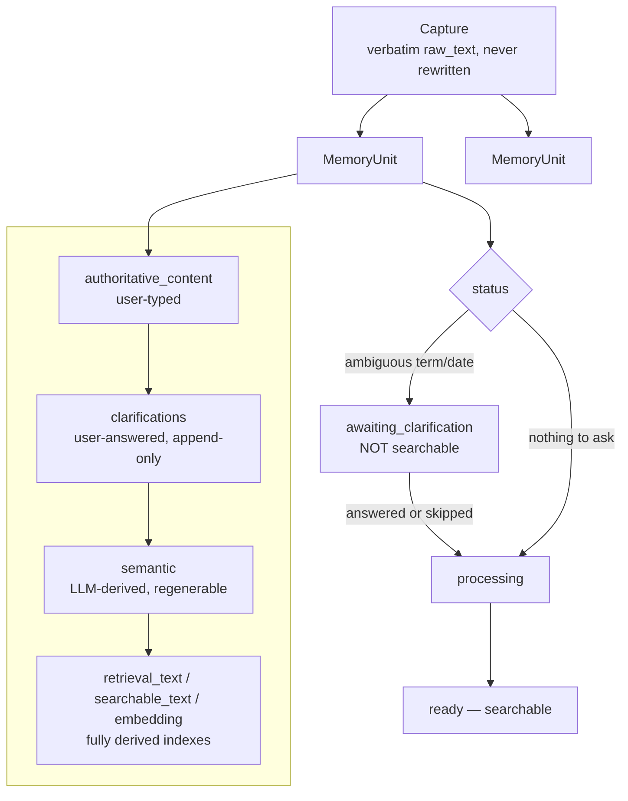
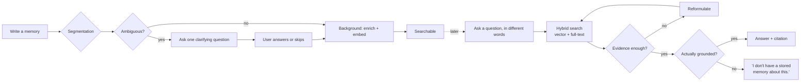

# membase

**An exploration of augmented personal memory, at the boundary of
information retrieval, language models, and human-computer interaction.**

membase is a research prototype, not a product: an investigation into
what it takes to build a system that *remembers for you* — honestly,
auditably, and without inventing things it doesn't actually know — rather
than one that merely searches text or generates plausible-sounding
answers about it.

## What this investigates

- **Information retrieval** — combine exact lexical matching with
  semantic/vector search, over *both* the original text and what a model
  derived from it, without letting the derived layer quietly replace the
  original as the thing being searched.
- **Grounding as a retrieval property, not a generation afterthought** —
  a system that can *refuse* to answer, and say so plainly, when its own
  retrieved evidence doesn't actually support a claim.
- **LLMs as a provisional inference layer, never a database** — every
  model-derived field is explicitly regenerable, layered strictly
  underneath what the person actually typed, never overwriting it.
- **Human-computer interaction** — when is it worth interrupting someone
  with a clarifying question, and when does that turn a two-second note
  into an interrogation? How much ambiguity should recall resolve
  silently, versus hand back to the person, versus simply admit it
  doesn't know?

## What it does

- **Capture → one or more memory units.** One piece of writing may
  describe several unrelated facts; the system decides whether to split
  it, not the person.
- **An authority hierarchy, enforced structurally.** User-typed >
  user-clarified > LLM-inferred > fully-derived indexes. Correcting or
  re-deriving the lower layers never touches the higher ones.
- **Clarification as gating, not chat.** A genuinely ambiguous term can
  hold a memory out of search until answered — bounded, skippable, and
  a real answer becomes permanent semantics, not a chat turn.
- **Grounded retrieval, explicit abstention.** Hybrid search over
  original text, derived semantics, and chunked attachments; the system
  says "I don't have a stored memory about this" rather than guess.
- **An iterative recall mode.** A separate, fully-implemented path that
  asks one concrete discriminating question when several memories are
  plausible, instead of picking arbitrarily.
- **A background "structurer" pass.** Deepens an already-answerable
  memory's representation over time, without ever blocking on it.
- **Contradiction surfacing, not resolution.** Disagreeing memories get
  flagged to be stated plainly later, never silently resolved.

## Architecture

Authority hierarchy, in words

Highest to lowest: what the person typed → what they later clarified →
what the model inferred → the fully-derived search indexes built from
all of it. Nothing downstream is ever allowed to overwrite something
upstream of it — a re-embed or a re-analysis can only touch its own
layer and below.

## Workflow

Why abstention is a first-class outcome, not an error case

The retrieval agent is instructed to mark an answer "grounded" only if it
actually addresses the question using what was retrieved. If nothing
qualifies, the fixed abstention string is returned with no sources — the
same code path as a real answer, not a fallback or an exception.

## Further reading

<code>docs/ARCHITECTURE.md</code> — the full design

Every abstraction above (`Capture`, `MemoryUnit`, the authority
hierarchy, the status gate, the retrieval `Agent`, `RecallSession`)
described in full, including the parts not covered here.

<code>docs/DECISIONS.md</code> — the decision log

What was tried, what was reversed, and why — including the ideas that
didn't survive contact with evaluation.

<code>docs/REPORT.md</code> — engineering/evaluation history

Phase-by-phase findings against the real local model, not just unit
tests against fakes.

<code>docs/TODO.md</code> — open questions

What this investigation hasn't settled yet.

## License

[MIT](LICENSE)
